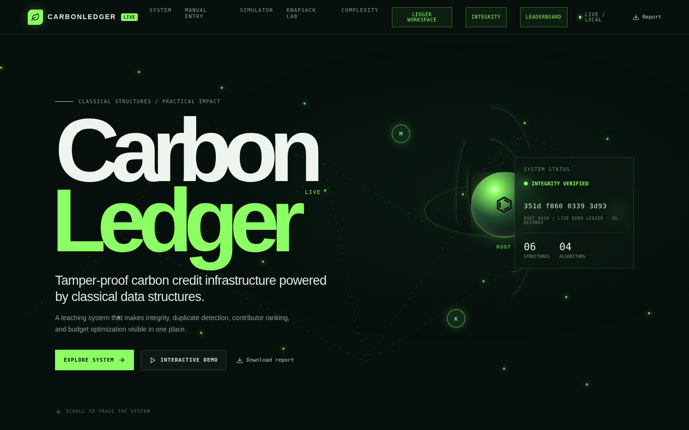
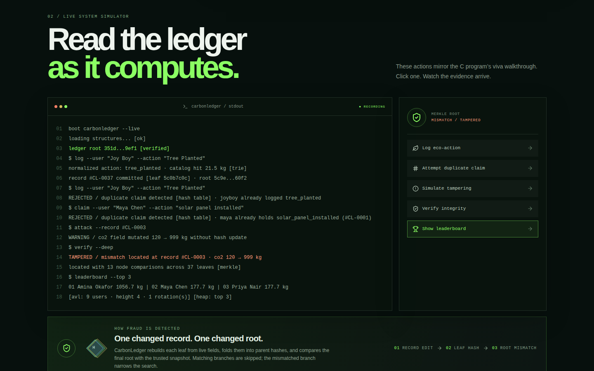

# CarbonLedger

[](https://github.com/dharanh72-cloud/carbonledger/actions/workflows/ci.yml)

A tamper-evident carbon-credit ledger, built to show six data structures and algorithms doing real work on one problem
instead of six toy demos. Log eco-actions, reject duplicate claims, rank contributors, allocate a green-fund budget, and
**prove after the fact whether any record was edited, and which one**.

It exists twice, with the same core logic: a terminal application in **C99** (standard library only) and a browser
dashboard in **React + TypeScript** that runs the same structures client-side with no backend.



## What it demonstrates

| Problem | Structure | Cost | C | TypeScript |
|---|---|---|---|---|
| Detect a silent edit anywhere in the ledger; locate the record | **Merkle tree** | verify O(n); locate one record O(log n) | `c-version/src/merkle.c` | `web/client/src/lib/dsa/merkle.ts` |
| Sorted per-user registry that survives sorted input | **AVL tree** (LL/RR/LR/RL rotations) | O(log n) insert/update/search | `avl.c` | `avl.ts` |
| Reject a duplicate claim before it is written | **Hash table**, separate chaining | O(1) average | `hash.c` | `hashTable.ts` |
| Validate and autocomplete action names | **Trie** | O(L) lookup, O(L + matches) autocomplete | `trie.c` | `trie.ts` |
| Top-K contributors without sorting everyone | **Max-heap** | build O(n) (TS heapify), extract O(k log n) | `heap.c` | `maxHeap.ts` |
| Spend a fixed budget on the best projects | **DP, Greedy, Branch & Bound** (0/1 knapsack) | O(n·W) / O(n log n) / pruned search | `knapsack.c` | `knapsack.ts` |

## Results

Measured, reproducible with `cd web && pnpm bench` (full tables in [docs/BENCHMARKS.md](docs/BENCHMARKS.md)):

- **Tamper localisation:** one edited record among **100,000** is found with **35 node comparisons** instead of scanning 100,000.
- **AVL vs unbalanced BST, sorted keys:** height **17** for 100,000 keys; a plain BST degenerates to height 100,000.
- **Knapsack (6 projects, budget 220):** DP and Branch & Bound save **87 kg CO2**, Greedy only **70 kg** (19.5% worse).
  Branch & Bound visits 22 of 127 tree nodes.



## Run it

**C version**
```bash
cd c-version
make            # builds with -Wall -Wextra -Werror
make test       # 13 end-to-end tests against the real binary
./carbonledger  # Windows: .\carbonledger.exe
```
Without `make`: `gcc -Wall -Wextra -Iinclude src/*.c -o carbonledger`.

**Web dashboard** (Node 22, pnpm)
```bash
cd web
pnpm install
pnpm dev        # http://localhost:3000
pnpm check      # type check
pnpm test       # 23 tests (20 cover the data-structure library)
pnpm build
```
Records are saved in the browser's `localStorage` on that machine. Use **Download backup / Restore backup** in the app to
move them. The simulator and the integrity, leaderboard and solver views are computed live by the library above.

## Tests and the bugs they found

CI (`.github/workflows/ci.yml`) builds the C code with warnings as errors, runs the C end-to-end suite, then type-checks,
tests and builds the web app. The tests are written to catch edge cases: tamper localisation is checked at **every index
for ledger sizes 1 to 8** (C) and for sizes 1, 2, 3, 5, 8, 13, 64 and 100 (TypeScript), DP and Branch & Bound are checked
against brute force on 60 random instances, and SHA-256 is checked against published vectors and Node's `crypto`.

Defects found while building this, all fixed:

- **Wrong record reported for non-power-of-two ledgers (C), found by the tests.** Localisation split index ranges at the
  midpoint, but the tree is built by pairing, so halves are not equal. With 5 records, tampering record 3 reported
  record 2. Nodes now store the range they cover.
- **Infinite loop when input ends at the menu (C), found by the tests,** for example Ctrl+D or a closed pipe. It now exits and saves.
- **The same record reported several times (TypeScript), found by the tests,** for unpaired nodes that are paired with themselves.
- **Found by reading the web code:** "DP" and "Branch & Bound" were both plain brute force, the "SHA-256" label sat on a
  32-bit hash, and the simulator printed fixed text. All three are now real implementations whose output is computed.

## Design notes and limitations

- **Where the trust anchor lives.** In the C version the trusted tree is held in memory and rebuilt from the data file on
  start, so a record edited in `carbonledger.dat` between runs is accepted as the truth. In the web app each record's
  leaf hash is stored next to the record in `localStorage`, so someone who edits both in DevTools is not detected. The
  Merkle check catches accidental and naive edits; a real deployment would anchor the root outside the machine
  (publish it, or sign it).
- **C hashing is not cryptographic.** It is a djb2-style hash on `unsigned long`, which is 32 bits on Windows and 64 bits
  on Linux, so roots and `carbonledger.dat` are not portable across platforms. The web app uses SHA-256.
- **The web app is client-only.** The `web/server` folder is leftover template code (auth, database schema, other helpers)
  that the offline workspace does not use.
- Fixed capacity in C (`MAX_RECORDS`), single user, no locking on the data file.

## Layout

```
c-version/   C99 terminal app: src/, include/, Makefile, tests/smoke.sh
web/         React + Vite + TypeScript dashboard
  client/src/lib/dsa/   the data-structure library (pure TypeScript, unit tested)
  server/dsa.test.ts    its tests
  scripts/bench.ts      benchmarks
docs/        benchmarks and screenshots
```

## Deploy the web app

Import the repo in Vercel and set **Root Directory** to `web`. `web/vercel.json` sets the build command, the output
directory (`dist/public`) and the single-page-app rewrite.
